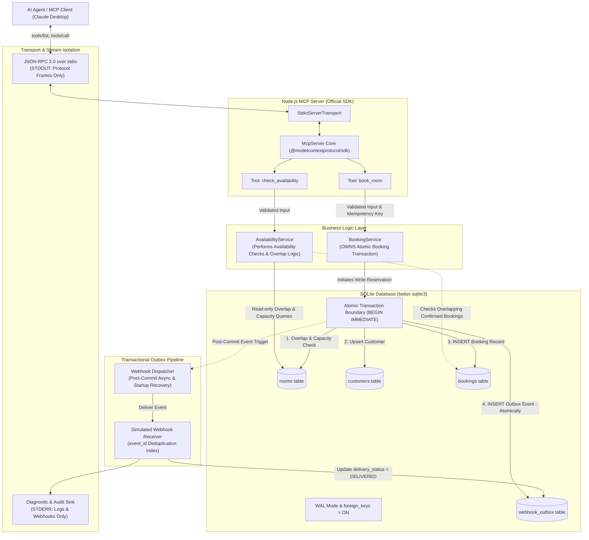

# Hotel Booking MCP Server: Architecture Specification

This document provides the architectural specification and component interaction diagrams for the Hotel Booking MCP Server.

---

## 1. System Architecture Diagram

---

## 2. Service Ownership & Boundaries

### 2.1 `AvailabilityService` (Search & Query Boundary)
- **Role:** Performs read-only availability calculations and queries.
- **Responsibilities:**
  - Evaluates half-open intervals $[ \text{check\_in}, \text{check\_out} )$.
  - Queries `rooms` that have status `'AVAILABLE'`, have `capacity >= guests`, and have no overlapping confirmed reservations in `bookings`.
  - Calculates stay duration (nights) and total pricing in USD cents.
  - **Does NOT initiate database write transactions or generate booking events.**

### 2.2 `BookingService` (Atomic Transaction Owner)
- **Role:** Owns the end-to-end atomic reservation transaction.
- **Responsibilities:**
  - Coordinates input normalization and generates canonical SHA-256 request hashes.
  - Controls the `better-sqlite3` **`BEGIN IMMEDIATE`** transaction boundary (`db.transaction(fn).immediate()`), acquiring SQLite's database-level `RESERVED` write lock before any read checks are performed.
  - Manages full-payload idempotency: matching keys replay original confirmations (`is_idempotent_replay: true`), while altered payloads fail with `IDEMPOTENCY_CONFLICT`.
  - Verifies room eligibility, capacity, and conflicting confirmed bookings within the locked transaction.
  - Upserts the customer record.
  - Inserts the confirmed booking record into `bookings`.
  - **Atomically inserts the `booking.created` event into `webhook_outbox` within the exact same database transaction.**
  - Triggers post-commit dispatch only after the transaction commits successfully.

---

## 3. Webhook Outbox & Concurrency Guarantees

### 3.1 Transactional Outbox Pattern
A booking failure or database error rolls back the transaction completely, guaranteeing that no booking row and no outbox event are persisted. Once committed, the outbox dispatcher guarantees **at-least-once delivery**:
1. **Immediate Post-Commit Dispatch:** Delivered asynchronously without delaying the client's MCP response.
2. **Backoff Schedule:** On transient failure, retries up to 5 total attempts with delays of **`1s, 5s, 15s, 30s`**.
3. **Dead-Letter State:** After 5 failed attempts, the event permanently transitions to `FAILED`.
4. **Crash Recovery Sweep:** On server restart, `WebhookService.recoverPendingEvents()` re-enqueues any undelivered `PENDING` events.
5. **Receiver Idempotency:** The simulated receiver maintains an in-memory `event_id` deduplication index to ensure duplicate delivery attempts do not cause duplicate side effects.

### 3.2 Concurrency & SQLite Writer Serialization
- SQLite serializes all write operations at the database level.
- By acquiring the write lock at the start of the transaction via `BEGIN IMMEDIATE`, concurrent writers wait for active reservations to commit before checking room availability.
- This design guarantees serializable isolation and eliminates double-booking race conditions without relying on unsupported row-level locks.
